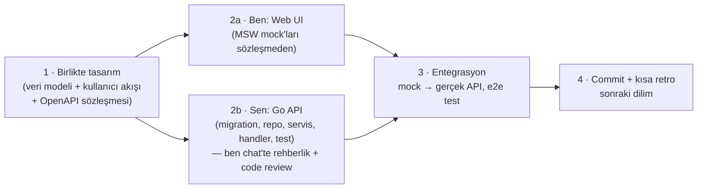

# 07 · Yol Haritası ve Geliştirme Sırası

> **Durum:** v0.5 · Faz 0–4 tamamlandı (güz dönemi hedefi, 2026-10-14) · Kararlar §5'te · İlerleme ve "Bitti" kontrol listesi §6'da.

## 1. Kritik Karar: Önce Backend mi, Frontend mi?

**Kısıtlar**

- Backend kodunu **sen** yazıyorsun (Go öğrenme projesi). Bu yolun **kritik yolu** (critical path) ve en yavaş ilerleyecek kısım burası. Bu bir sorun değil, projenin amacı zaten bu.
  - *Güncelleme (2026-10-08):* Go temelleri Ders 1–17'de atıldı. Bundan sonra kodun tamamını Claude yazıyor, Ahmet her dilimde inceliyor (bkz. §4 ve §5 #10).
- Web ve mobil frontend'i ajan olarak **ben** hızlı üretebilirim.
- Mobil en sona kalacak (karar verildi).

### Seçenekler

| | A) Önce backend (tamamen) | B) Önce frontend (tamamen) | **C) Sözleşme önce, dikey dilimler** |
| --- | --- | --- | --- |
| Nasıl | Tüm API biter, sonra UI | Tüm UI mock'larla biter, sonra API | Her modül için: birlikte veri modeli + OpenAPI sözleşmesi → ben UI'ı mock'la, sen API'yi gerçekle yazarsın → birleştir |
| Görünür ilerleme | Aylarca yok | Çok hızlı | Her dilimde |
| Yeniden iş riski | Düşük (UI'ın ihtiyacı geç fark edilir) | **Yüksek**: hayali API'ye göre UI, sonra uyumsuzluk | Düşük: sözleşme tek kaynak |
| Senin Go temposuna etkisi | Baskı yok ama motivasyon düşebilir | Backend'i UI'a uydurma baskısı | UI bir dilim önde gider, backend kendi temposunda yetişir |
| Tasarım kalitesi | API "veri odaklı" kalır, UX geç düşünülür | UX iyi, API tutarsız olabilir | UX ve API **birlikte** tasarlanır |
| Entegrasyon | Big-bang | Big-bang | Dilim dilim, küçük |

### Öneri: **C — Sözleşme önce, dikey dilimler**

- **Faz 0**'da iki taraf paralel temel atar. Sen: backend iskeleti. Ben: web tasarım sistemi ve uygulama kabuğu.
- Sonra her dilimde UI genellikle **bir dilim önde** olur. Sen bir modülün backend'ini yazarken ben bir sonrakinin UI'ını mock'la hazırlarım. Senin hızın kimseyi bekletmez, kimse de seni sıkıştırmaz.
- **OpenAPI sözleşmesi** (`contracts/openapi.yaml`) Go kodu değil, ortak tasarım belgesidir. Her dilimde ben taslağını çıkarırım, sen incelersin ve birlikte kesinleştiririz. İstersen sözleşmeyi de tamamen sen yazabilirsin, bu bir tercih.
- Her dilimin **"Bitti" tanımı (DoD)**: migration + repository + servis + handler + birim ve entegrasyon testleri + OpenAPI ile uyum + web ekranları + e2e senaryosu + metrikler + doküman güncellemesi + commit.

## 2. Fazlar

> Süreler kaba tahmindir. Bitirme projesinin iki döneme yayıldığı varsayılmıştır (Güz: Graduation Project I, Bahar: II). Kesin teslim tarihlerini öğrendiğimizde takvimi sabitleyeceğiz.

### Faz 0 — Temel (≈ 2 hafta)
| Sen (backend) | Ben (web + ortak) |
| --- | --- |
| `go mod init`, klasör yapısı, `cmd/api` ile `/healthz` | Vite + React + TS + Tailwind + shadcn kurulumu |
| Config struct'ı, `slog`, graceful shutdown | Tasarım sistemi: renkler, tipografi, açık/koyu tema, temel bileşenler |
| `docker compose`: PostgreSQL, Redis, nesne deposu (Faz 5'te SeaweedFS), Mailpit | Uygulama kabuğu: layout, sidebar, üst bar, program bağlamı seçici, i18n |
| İlk migration + `pgxpool` + `/readyz` | Redux store, RTK Query iskeleti, MSW kurulumu |
| `/metrics` + Prometheus + Grafana (compose'a eklenir) | ESLint/Prettier/Vitest, CI (GitHub Actions) |

**Go konuları:** modüller, paketler, `net/http`, `http.ServeMux` desenleri, middleware, `context`, `log/slog`, `os/signal`, pgx havuzu, migration'lar, `testing` temelleri.

### Faz 1 — IAM + Organizasyon + Seed (≈ 3–4 hafta)
- Giriş, refresh rotasyonu, çıkış, şifre sıfırlama, oturumlar, rate limit, rol/yetki çözümleme, politika iskeleti, denetim izi.
- Organizasyon (fakülte → program, derslik), kişiler, danışman ataması.
- **Seed üretici** (`cmd/seed`): ~92 bin öğrenci, ~10 bin akademisyen, fakülteler, Bilgisayar Mühendisliği müfredatı (gerçek), sentetik diğer programlar.
- Web: giriş, şifre sıfırlama, oturumlarım, profil, rol bazlı menü, kontrol paneli iskeleti.

**Go konuları:** `crypto/ed25519`, `crypto/rand`, `crypto/subtle`, `crypto/hmac`, argon2, **JWT'yi elle yazma**, `encoding/json`/`base64`, Redis, Lua ile rate limit, tablo güdümlü testler, testcontainers.

### Faz 2 — Takvim + Müfredat + Ders Açma (≈ 3 hafta)
- Akademik yıl/dönem, takvim olayları ve **pencere motoru**, müfredat versiyonları, seçmeli gruplar, ön koşullar, not ölçeği, ders açma, şube, kontenjan, haftalık program ve çakışma kontrolü, değerlendirme planı.
- Web: akademik takvim, ders planı (müfredat), ders kataloğu, haftalık program, bölüm başkanı için ders açma ekranları.

**Go konuları:** repository deseni, transaction yardımcısı, cursor sayfalama (generics ile), PostgreSQL range tipleri ve `EXCLUDE` kısıtları, doğrulama.

### Faz 3 — Ders Seçme ★ (≈ 4 hafta, projenin kalbi)
- Program kaydı, alınabilir dersler, sepet, **kural motoru** (AKTS/GANO, 1. sınıf zorunluluğu, alttan ders önceliği, ön koşul, çakışma, kontenjan, engel, azami süre), danışmana gönder/onay/red, outbox → (ileride LMS üyeliği), kayıt onay raporu.
- Danışman ekranı: öğrenci listesi, toplu inceleme, onay/red.
- **İlk k6 senaryosu: `registration-rush`** → kontenjan aşımı = 0 kanıtı.

**Go konuları:** goroutine/channel, `sync`, `errgroup`, **race detector**, advisory lock, koşullu atomik UPDATE, iyimser kilit, idempotentlik, outbox deseni, `pprof`.

### Faz 4 — Değerlendirme ve Not (≈ 3 hafta)
- Bileşen notu girişi (pencere + eğitmen kontrolü), harf notu hesaplama, ilan, sınıf istatistikleri, bütünleme, YANO/GANO, transkript, sanal transkript ("ne olur" simülatörü), not düzeltme talebi.

**Go konuları:** ondalık aritmetik (float yok: tamsayı yüzdelik ya da `pgtype.Numeric`), kural motoru tasarımı, özellik tabanlı (property-based) test fikri, `text/template` ile rapor.

> **Güz dönemi sonu hedefi (Graduation Project I):** Faz 0–4 → giriş yapan öğrenci ders seçer, danışman onaylar, eğitmen not girer, öğrenci transkriptini görür. Çalışan bir dikey MVP + ilk yük testi sonuçları.

### Faz 5 — LMS Çekirdeği (≈ 4 hafta)
- Ders alanı (kayıt onayında otomatik üyelik), bölümler, dosya/klasör/link/sayfa, ödev + teslim + puanlama + geri bildirim, **not öğesi ↔ değerlendirme bileşeni köprüsü**, forum, zaman çizelgesi, ilerleme.

**Go konuları:** multipart upload'u stream etme, `io.Reader`/`Writer` kompozisyonu, S3 (SeaweedFS, `minio-go`), imzalı URL, HTML temizleme, dosya tipi tespiti.

### Faz 6 — İletişim (≈ 2–3 hafta)
- Duyurular (hedef kitle), bildirim merkezi + tercih matrisi, **SSE** ile canlı bildirim, e-posta (outbox + worker), mesajlaşma.

**Go konuları:** SSE (`http.Flusher`), Redis pub/sub, worker pool, `net/smtp`, `html/template`, üstel geri çekilme.

### Faz 7 — Yoklama, Sınav (quiz), Anket, Belgeler (≈ 4 hafta)
- Yoklama oturumları ve girişi, quiz ve soru bankası, anonim ders değerlendirme anketi + anket kapısı, belge üretimi (PDF) + imza + doğrulama kodu/QR + halka açık doğrulama sayfası.

**Go konuları:** zaman ve takvim hesapları, JSONB ile esnek modeller, PDF üretimi, imzalama, QR üretimi.

### Faz 8 — Analitik / OLAP (≈ 3 hafta)
- `agora_dw`, boyutlar ve olgular, ETL worker'ı, sentetik geçmiş dönem verisi, Grafana iş panelleri, uygulama içi analitik, risk skoru ve danışman risk paneli.

**Go konuları:** batch işleme, `COPY` protokolü, zamanlanmış işler, idempotent upsert, iki veritabanıyla çalışma.

### Faz 9 — Sertleştirme ve Performans (≈ 3 hafta)
- Tüm k6 senaryoları, darboğaz analizi (`pg_stat_statements`, pprof), önbellekleme, index iyileştirme, güvenlik taraması (ZAP, gosec, govulncheck, Trivy), ASVS kontrol listesi, (opsiyonel) RLS, (opsiyonel) OpenTelemetry tracing, SLO panosu.

**Go konuları:** benchmark'lar, kaçış analizi (escape analysis), `sync.Pool`, profil okuma, bellek ve GC ayarı.

### Faz 10 — Mobil (≈ 4 hafta)
- Expo uygulaması: giriş (secure store), kontrol paneli, ders programı, notlar/transkript, LMS içerik ve ödev teslimi, bildirimler (push), QR yoklama (P2).

### Faz 11 — Dağıtım, Dokümantasyon, Teslim (≈ 2 hafta)
- VPS + Docker Compose + Caddy, demo verisi, kullanım kılavuzu, mimari doküman güncellemesi, bitirme raporu, sunum.

## 3. İlk Somut Adımlar (karar sonrası)

1. Sen kararları verirsin (§5).
2. Ben: `docs/` dokümanlarını kararlarına göre güncellerim. Kökte `docker-compose.yml` iskeleti ve `contracts/openapi.yaml` iskeleti hazırlarım. Backend klasörüne **dokunmam**.
3. Sen: Faz 0 backend'ine başlarsın. İlk dersimiz Go modül yapısı, `net/http` ve Spring'deki karşılıkları. Kodu ben chat'te adım adım açıklarım, sen yazarsın.
4. Ben paralelde: web iskeleti + tasarım sistemi + uygulama kabuğu.

## 4. Çalışma Kuralları (özet)

- Her küçük başarıdan sonra Türkçe, önek kullanmayan commit, yazar CAPELLAX02. Her commit'ten önce `make check` (ve web'de karşılığı) yeşil olmalı.
- Ders 17'ye kadar `backend/` kodunu Ahmet yazdı. Ders 17'den sonra bütün kodu Claude yazar. Ahmet her dilim sonunda inceler, "devam" demeden sonraki dilime geçilmez.
- **Bir faz tamamen bitmeden sonrakine geçilmez:** önce o fazın backend'i eksiksiz (sözleşme, migration, servis, uç, test), sonra web ekranları, sonra uçtan uca testler ve doküman. §6'daki kontrol listesinin bütün maddeleri işaretlenince faz kapanır.
- Her dilimde sözleşme koddan **önce** güncellenir. Doküman ve kontrol listesi aynı commit dizisinde güncellenir.

## 5. Kararlar (2026-10-05)

| # | Konu | Karar |
| --- | --- | --- |
| 1 | Geliştirme sırası | **C — sözleşme önce, dikey dilimler**. Başlangıçta Go temelleri ağırdan alınır, backend temeli önce atılır |
| 2 | OpenAPI sözleşmesi | Taslak Claude, inceleme ve son karar Ahmet |
| 3 | Ortak paketler (`packages/api-types`, `packages/i18n`) | Evet, pnpm workspaces ile (ihtiyaç doğduğunda) |
| 4 | Migration aracı | goose (düz SQL) |
| 5 | JWT | Stdlib Ed25519 ile elle + kapsamlı testler |
| 6 | SQL erişimi | Elle yazılmış SQL + pgx. sqlc Faz 9'da karşılaştırma olarak denenebilir |
| 7 | Kampüs yaşamı özellikleri | Opsiyonel P2 |
| 8 | Teslim takvimi | **Açık**. Tarihler öğrenilince fazlar sabitlenecek |
| 9 | Seed müfredatı | Bilgisayar Mühendisliği'nin halka açık gerçek ders planı kullanılacak |
| 10 | Kodu kim yazar (2026-10-08) | Ders 17'ye kadar backend'i Ahmet yazdı. Bundan sonra bütün kodu Claude yazar, Ahmet dilim sonlarında inceler |
| 11 | Faz kapanışı (2026-10-08) | Bir faz, §6'daki bütün maddeleri (backend + web + e2e + doküman) bitmeden kapanmaz. Backend'i bitmemiş bir fazın web'ine geçilmez |
| 12 | Geçmiş ders sonuçları (2026-10-11) | Kural motoru (GANO, alttan ders, ön koşul) geçmiş dönem sonuçlarına dayanır. Bu sonuçlar Faz 3'te eski sistemden aktarılmış kayıtlar olarak (`source = IMPORT`) seed'lenir; not girişi, harf notu hesabı ve resmî YANO/GANO Faz 4'te gelir |
| 13 | Ders seçmenin demosu (2026-10-11) | Gerçek takvimde 2026 güz ders seçmesi geçmişte kalır. Geliştirme seed'i, Bilgisayar Mühendisliği programı için kayıt pencerelerini seed'in çalıştığı ana göre açan **program kapsamlı** takvim olayları ekler (açıklamasında demo olduğu yazar). Üniversite takvimi değişmez; pencere motoru en dar kapsamı uyguladığı için sadece bu program etkilenir. Not girişi demosu (2026-10-14) aynı yaklaşımla **fakülte kapsamlıdır** (Mühendislik): not girişi pencereleri şubenin fakültesinde çözülür |
| 14 | Puan aritmetiği (2026-10-11) | Puan ve ağırlıklar veritabanında `numeric`, Go'da yüzde birlik tamsayı (`int64`); kayan nokta kullanılmaz. Ders başarı puanı tam sayıya yarım yukarı yuvarlanır ve ölçeğin aralığına bakılır (yönetmelik metninden doğrulanacak) |
| 15 | Not girişi ve ilanında MFA (2026-10-11) | Yetki kataloğunda `score:enter` ve `grade:finalize` MFA ister: öğretim elemanı not girmeden önce iki adımlı doğrulamayı kurar. Demo ve e2e bunu da gösterir |
| 16 | Bütünleme hakkı (2026-10-11) | Hangi harf notlarının bütünleme hakkı verdiği yönetmelik parametresidir (`makeup_eligible_letters`, varsayılan `["F2", "BŞZ"]`: harf notlu derste F2, başarılı/başarısız notlu derste BŞZ); devamsız öğrenci (F1 ya da devamsızlıktan BŞZ) bütünlemeye giremez. Bütünleme notu, puan olarak girilmişse final notunun yerine geçer; bütünlemeye girmeyenin notu değişmez. Bütünleme sonuçları bir kez ilan edilir, önceki harf not geçmişinde kalır |
| 17 | Transkript belgesi (2026-10-11) | Faz 4'te ekran ve yazdırılabilir görünüm. İmzalı PDF, doğrulama kodu ve belge talebi Faz 7'nin belge altyapısıyla |
| 18 | Toplu içe aktarmada Excel şablonları (2026-10-14) | Her toplu içe aktarma senaryosu (ilk örnek bileşen notları) sunucunun ürettiği profesyonel bir Excel şablonuyla gelir ve aynı dosya geri yüklenir; CSV de kabul edilir. Ortak katman `internal/platform/sheet` (excelize): marka renkli başlık, başlık bloğu, düzenlenecek hücreler sarı ve kilitsiz, diğerleri gri ve kilitli (parolasız sayfa koruması), Excel'de hücre doğrulaması, açıklama sayfası, yazdırma ayarları ve çok gizli kimlik sayfası (dosyanın kaydı ve sütunların anlamı: başka kaydın şablonu reddedilir, başlık değişse de sütun bulunur). Okuma hoşgörülü ve tek yoldan: satır numaraları dosyadaki, başlık satırı aranır, önce satır satır önizleme, sonra tek transaction |
| 19 | Ders alanı = şube, üyelik türetilir (2026-10-14) | e-Kampüs'te her ders bir OBS şubesine 1:1 karşılık gelir ve onaylanan dersler "belirli aralıklarla" aktarılır. Agora'da ders alanının anahtarı şubedir (`lms.course_spaces.section_id` PK, ilk içerikle oluşur); üyelik kopyalanmaz, sorgu anında türetilir: öğrenci = şubede bırakmamış kesin kaydı olan, öğretim elemanı = şubeye atanmış (sorumlu, ortak, asistan). Kayıt onaylandığı transaction'da öğrenci derse erişir; senkronizasyon, gecikme ve kopukluk yoktur ("tek kaynak"). Gözlemci gibi elle üyelikler P2 |
| 20 | Dosya depolama (2026-10-14) | Dosyalar S3 uyumlu nesne deposunda, üst verisi `platform.files`'ta. Sunucu **SeaweedFS** (Apache 2.0): MinIO'nun topluluk imajları 2025'ten beri yayımlanmıyor (Docker Hub ve quay.io'da erişilemiyor). İstemci S3'e özgü olmayan `minio-go`; S3 uyumlu her sunucuyla (ileride bulut depolama) çalışır. Yükleme API'den akışla geçer (bellekte tutulmaz): boyut sınırı, içerikten tür tespiti ve uzantı izin listesi, yüklerken SHA-256. İndirmede yetki dosyanın sahibi olan varlık üzerinden denetlenir, ardından kısa ömürlü (5 dk) imzalı URL verilir: büyük dosyalar API'den ve tarayıcı belleğinden geçmez. Bir varlığa bağlanmayan dosyalar worker'da temizlenir |

## 6. İlerleme ve "Bitti" Kontrol Listesi

> Her commit'te ilgili madde işaretlenir. ✅ bitti · 🔄 sürüyor · ⬜ başlanmadı · ⏭️ bilinçli olarak sonraki faza taşındı (gerekçesiyle).

### Faz 0 — Temel

| Durum | Madde | Not |
| --- | --- | --- |
| ✅ | Go modülü, klasör yapısı, `/healthz`, config, `slog`, graceful shutdown | Ders 1–5 |
| ✅ | PostgreSQL + `pgxpool` + `/readyz`, goose migration'ları | Ders 6–9 |
| ✅ | `/metrics`, Prometheus, Grafana (panolar kod olarak) | Ders 11–12 |
| ✅ | Backend CI (gofmt, vet, staticcheck, govulncheck, race testleri) | |
| ✅ | Redis | Ders 16 |
| ✅ | Mailpit (geliştirme SMTP) | `http://localhost:8025` |
| ✅ | Nesne deposu | SeaweedFS, Faz 5'te dosya yüklemeyle birlikte eklendi: kullanılmayan servis compose'da durmasın diye beklendi (§5 #20) |
| ✅ | Web: Vite + React + TS + Tailwind + shadcn, ESLint/Prettier/Vitest | pnpm (corepack), TypeScript strict, tip bilgili ESLint |
| ✅ | Web: tasarım sistemi, açık/koyu tema, uygulama kabuğu, i18n | Radix tabanlı bileşenler, OKLCH renk belirteçleri, TR/EN (anahtarlar tip kontrollü, iki dilin eşliği testli) |
| ✅ | Web: Redux store, OpenAPI'den RTK Query istemcisi, MSW | Access token sadece bellekte, 401'de tek uçuşlu sessiz yenileme, MSW ile bütünleşik testler |
| ✅ | Web CI | Biçim, lint, tip, test, build; üretilmiş istemcinin sözleşmeyle uyumu |

### Faz 1 — IAM + Organizasyon + Seed

**Backend**

| Durum | Madde | Not |
| --- | --- | --- |
| ✅ | Parola hash'leme (argon2id) ve parola politikası | Ders 10 |
| ✅ | JWT (Ed25519) elle | Ders 12 |
| ✅ | Giriş, refresh rotasyonu ve yeniden kullanım tespiti, çıkış | Ders 14–15 |
| ✅ | Hesap kilitleme, giriş hız sınırı, anında oturum iptali | Ders 14, 16 |
| ✅ | Rol/yetki çözümleme, politikalı router (varsayılan ret), sürümlü yetki önbelleği | Ders 17 |
| ✅ | Güvenlik başlıkları ve CORS | Sıkı CSP, nosniff, HSTS (HTTPS ortamlarında), origin listesiyle CORS |
| ✅ | Denetim izi (`audit.audit_log`) ve güvenlik olayları (`audit.security_events`), aylık partition | Giriş, çıkış, kilit ve yeniden kullanım olayları; `GET /audit/log`, `GET /audit/security-events`. Saklama süresine göre arşivleme worker'la, `INSERT`-only DB rolü Faz 9'da |
| ✅ | Parola değiştirme, `must_change_password` zorunluluğu | `POST /me/password`, `SelfService` politikası, diğer oturumlar kapanır, yanlış mevcut parola kilit sayacını artırır |
| ✅ | E-posta outbox'ı ve `cmd/worker` (SMTP, üstel geri çekilme) | `SKIP LOCKED` + kira ile çoklu worker, gönderimden sonra gizli veri silinir, `agora_outbox_*` metrikleri, günlük bakım işi |
| ✅ | Şifre sıfırlama (30 dk, tek kullanımlık token, bütün oturumlar iptal) | `forgot` her zaman 202, hesap başına 2 dk kısma, IP hız sınırı, token URL parçasında (#), `FOR UPDATE` ile tek kullanım, PENDING hesap etkinleşir |
| ✅ | Oturumlarım: listeleme, tek oturumu kapatma, diğer oturumları kapatma | Cihaz bilgisi User-Agent'tan, kapatılan oturumların access token'ları anında geçersiz, `GET /me/security-events` ile giriş geçmişi |
| ✅ | Kullanıcı yönetimi: listeleme, oluşturma (aktivasyon e-postasıyla), askıya alma | Hesap PENDING başlar, parolayı kullanıcı belirler; askıya almada oturumlar anında kapanır; kendi hesabında işlem yasak; denetim kaydı |
| ✅ | Rol kataloğu, rol atama ve sonlandırma (görevler ayrılığı, denetim izi) | Kendine rol atanamaz, kapsam doğrulaması, ileri tarihli atama, son sistem yöneticisi korunur (advisory lock + `clock_timestamp()`), değişiklik anında etkili |
| ✅ | Organizasyon: binalar ve derslikler | Kapsamlı yetki (binanın birimi), iyimser kilit (ETag/If-Match, 412/428), denetim kaydı, geliştirme seed'i |
| ✅ | Program kaydı (`enrollment.student_programs`) ve danışman ataması | Yetkili kümeden listeleme, danışman rolü ilişkiye dayalı (bölümü kapsamaz), erişim yoksa 404, danışman geçmişi. Müfredat/dönem bağlantıları Faz 2'de |
| ✅ | İş metrikleri (`agora_login_failures_total`, `agora_refresh_reuse_detected_total` …) | Girişler, başarısız girişler (sebebe göre), kilitlenmeler, token yeniden kullanımı, parola sıfırlama, hız sınırı; Grafana'da "Kimlik doğrulama ve güvenlik" ve "Worker" satırları |
| ✅ | Seed üretici: ~92 bin öğrenci, ~10 bin personel, sentetik programlar, danışmanlar | `make seed-synthetic` (~6 sn, COPY + tek transaction, belirlenimci tohum); 68 programlık katalog; arama için trigram index'leri (75 ms → 0,7 ms). Gerçek BM müfredatı Faz 2'de müfredat modeliyle |
| ✅ | MFA (TOTP) ve kurtarma kodları | RFC 6238 (resmi test vektörleriyle), sır AES-256-GCM ile şifreli ve kullanıcıya bağlı, tekrar oynatma koruması, iki adımlı giriş (5 dk, 5 deneme, ortak kilit sayacı), 10 kurtarma kodu (HMAC), hassas yetkiler sadece MFA'lı oturumda (`403 MFA_REQUIRED`), yönetici sıfırlaması |

**Web**

| Durum | Madde |
| --- | --- |
| ✅ | Giriş, oturum geri yükleme (sessiz refresh), çıkış |
| ✅ | Parola değiştirme (ilk girişte zorunlu), şifre sıfırlama ve hesap aktivasyonu |
| ✅ | İki adımlı doğrulama: girişin ikinci adımı, kurulum (QR), kurtarma kodları, MFA öneri bandı |
| ✅ | Oturumlarım, güvenlik geçmişi, profil |
| ✅ | Rol bazlı menü, kontrol paneli iskeleti |
| ✅ | Yönetim: kullanıcılar, hesap işlemleri, rol atama, MFA sıfırlama, denetim kayıtları |

**Kapanış**

| Durum | Madde |
| --- | --- |
| ✅ | Playwright e2e: giriş, ilk girişte parola değiştirme, şifre sıfırlama, MFA kurulumu ve iki adımlı giriş, rol atamasının anında etkisi, hesap aktivasyonu (gerçek yığınla, CI'da da) |
| ✅ | Sözleşme ve dokümanlar güncel, CI yeşil. Go 1.27.2'ye geçildi (net/http HTTP/2 açıkları GO-2026-6611/6612/6613/6617); staticcheck ve govulncheck `backend/tools` modülünde sabitlendi |

### Faz 2 — Takvim + Müfredat + Ders Açma

**Backend**

| Durum | Madde | Not |
| --- | --- | --- |
| ✅ | Akademik yıl ve dönemler, tek aktif dönem | `academic.academic_years`, `academic.terms`, kısmi benzersiz index ile tek aktif dönem; yıl ve dönem tanımı üniversite geneli yetki ister |
| ✅ | Takvim olayları ve pencere motoru | Tipli zaman pencereleri, kapsam (üniversite → fakülte → program) geçersiz kılma, aynı kapsamda çakışma yok (`EXCLUDE`), taslak olaylar, `GET /calendar/windows` |
| ✅ | Ders kataloğu, ön koşullar (VE/VEYA grupları), eşdeğerlikler | `curriculum.courses`; kod sabit (değişen ders yeni kodla açılıp eşdeğerlikle bağlanır), ön koşul kümesi tek seferde değişir, döngü özyinelemeli sorguyla engellenir (`PREREQUISITE_CYCLE`), eski ↔ yeni kod eşdeğerliği; bölüm kapsamlı yetki |
| ✅ | Seçmeli gruplar ve ders havuzları | Teknik seçmeli, üniversite alan dışı, pedagojik formasyon, genel sosyal; havuz üyeliği idempotent `PUT` |
| ✅ | Versiyonlu müfredat ve öğrenci program kaydına bağlantı | Taslak → yürürlükte → arşiv; yürürlükteki sürümlerin giriş yılları çakışamaz (`EXCLUDE`); yürürlüğe girerken AKTS toplamı ve yarıyıl sınırı doğrulanır, aralıktaki öğrenci kayıtları bağlanır; ders satırı ve seçmeli yuva; `GET /me/curricula` |
| ✅ | Not ölçeği ve yönetmelik parametreleri (veri olarak) | Ankara Üniversitesi lisans ölçeği (A … F2, F1 devamsızlık, BŞR/BŞZ, MUAF); puan aralıkları 0-100'ü boşluksuz kapsar (`EXCLUDE` + doğrulama), tek varsayılan ölçek; parametreler tarihli (`daterange` çakışmasız), yeni değer eskisini kapatır, JSON türü korunur |
| ✅ | Ders açma, şube, kontenjan ve program bazlı alt kontenjan, öğretim elemanı ataması | Bir ders dönemde bir kez açılır, öğrenci grupları şubelerle; durum geçişleri (planlama → açık → kapalı, iptal); kontenjan kayıtlı sayının ve program kontenjanları toplamının altına inemez (`CHECK`); tek sorumlu öğretim elemanı (kısmi benzersiz index), sadece görevdeki akademik personel; bölüm kapsamlı yetki |
| ✅ | Haftalık program ve çakışma kontrolü | `timerange` tipi; derslik ve şube içi çakışma veritabanında (`EXCLUDE`), öğretim elemanı çakışması serviste (dönem başına advisory lock ile yarışsız); teorik oturumda derslik kapasitesi; çakışma mesajı dersi ve saati söyler; bölüm, derslik ve öğretim elemanı programı, `GET /me/teaching` |
| ✅ | Değerlendirme planı | `grading` şeması; bileşenler ve ağırlıklar (dönem içi + final = 100, tek final), bütünleme finalden türetilir; bileşen kimlikleri yeniden yazmada korunur (notlar bağlanacak); düzenleme ilişkiye dayalı (şubenin öğretim elemanı) ya da bölüm; kilidi öğretim elemanı koyar, gerekçeyle bölüm açar |
| ✅ | Seed: gerçek BM (İngilizce) müfredatı, 2026-2027 takvimi, not ölçeği, BM güz dönemi ders açma ve programı | Müfredat bölümün yayımladığı formlardan (2022, 2023, 2026 sürümleri; 170 ders, 42 eşdeğerlik); takvimde fakülte kapsamlı uzatma örneği; 38 ders açma repository'ler üzerinden (çakışma ve kapasite denetimli), seed testi CI'da gerçek SQL seed'leriyle çalışır; öğrenciler giriş yılına göre müfredata bağlanır |

**Web**

| Durum | Madde |
| --- | --- |
| ✅ | Akademik takvim: dönem seçici, açık/kapalı pencereler, olay yönetimi |
| ✅ | Ders kataloğu ve ders detayı (ön koşul, eşdeğerlik, havuzlar) |
| ✅ | Ders planı (müfredat): öğrenci için kendi programı (program bağlamı seçici), personel için program ve sürüm gezgini, taslak düzenleme |
| ✅ | Haftalık program görünümü (öğretim elemanı, bölüm, derslik) |
| ✅ | Ders açma ekranları (bölüm başkanı): ders açma, şube, kontenjan, öğretim elemanı, program yerleşimi ve çakışma geri bildirimi |
| ✅ | Değerlendirme planı (öğretim elemanı) ve not ölçeği |

**Kapanış**

| Durum | Madde |
| --- | --- |
| ✅ | Playwright e2e: takvim penceresi, müfredat görüntüleme, ders açma ve çakışma senaryoları (seed'in gerçek BM verisiyle, tarihten bağımsız; derslik ve öğretim elemanı çakışma mesajları) |
| ✅ | Sözleşme ve dokümanlar güncel (veri modeli, yetkilendirme politikaları, README'de akademik veri ve demo hesap rehberi), CI yeşil (backend, web kontrolü ve Playwright) |

### Faz 3 — Ders Seçme ★

**Backend**

| Durum | Madde | Not |
| --- | --- | --- |
| ✅ | Kayıt engelleri | `enrollment.holds`: katkı payı borcu, disiplin, eksik belge, kütüphane borcu; engelin neyi kapattığı (ders seçme, belge, mezuniyet); koyma ve gerekçeyle kaldırma (`hold:manage`, mali işler üniversite, fakülte öğrenci işleri fakülte kapsamı); öğrenci kendi engellerini görür |
| ✅ | Program kaydı durumu ve süreler | Durum geçişleri (dondurma, uzaklaştırma, ilişik kesme, mezuniyet) gerekçe ve karar numarasıyla, geçmişiyle; yarıyıl, normal süre ve azami süre (programın `max_duration_years` değeri) hesabı; dönem geçişinde aktif öğrencilerin yarıyılı outbox olayıyla bir kez ilerler (dondurulan dönem sayılmaz) |
| ✅ | Ders geçmişi (kesinleşmiş kayıtlar) | `enrollment.enrollments`: deneme numarası, tekrar alınan derste son not geçerli (`superseded_by`), harf notu not ölçeğinden; eski sistemden aktarılan geçmiş (`source = IMPORT`); müfredata göre ders durumu (geçti, kaldı, devam ediyor, alınmadı) eşdeğerlikler ve seçmeli havuzlarla |
| ✅ | Alınabilir dersler | Öğrencinin müfredatı ve dönemin açılan dersleri: alttan, dönem, seçmeli yuva, üst yarıyıl ve not yükseltme kategorileri; eski koddan kalan ders yeni eşdeğeriyle alınır; şubeler, programa göre kalan kontenjan, haftalık program, ön koşul durumu |
| ✅ | Kural motoru | Saf Go paketi, tablo güdümlü testler. Engel, program kaydı durumu, AKTS üst sınırı (GANO'ya göre, yönetmelik parametresi), 1. sınıf zorunlu dersleri, alttan ders önceliği, ön koşul (VE/VEYA, geçti/devam etti), haftalık program çakışması (devam şartını önceden sağlamış tekrar derste uyarı), müfredat dışı ders, azami süre (en çok 5 ders), not yükseltme ve seçmeli yuva aşımı uyarıları. Hata ve uyarı ayrımı; ekleme anında ve gönderimde ayrı kural kümeleri |
| ✅ | Sepet ve yarışa dayanıklı kontenjan | `registrations` (dönem başına tek), `registration_items`, `registration_events`; ekle, çıkar, şube değiştir. Öğrenci başına advisory lock; kontenjan sepete eklerken koşullu atomik `UPDATE` ile düşer (program alt kontenjanı dahil), çıkarınca serbest kalır; aynı dersin iki şubesi kısmi benzersiz index'le engellenir. Eşzamanlılık testi: yüzlerce goroutine aynı şubeye, kontenjan aşımı 0 (race detector açık) |
| ✅ | Danışman onayı | Gönder, geri çek, onayla, gerekçeyle reddet, onayı geri al (durum makinesi, `If-Match`); ders seçme ve danışman onayı pencereleri; onayda kesin kayıtlar oluşur; danışman için dönem ve durum filtreli öğrenci listesi, toplu onay; öğrenci işleri pencere dışında gerekçeyle müdahale eder (`registration:override`, denetime işaretli) |
| ✅ | Outbox | `platform.outbox_events` aynı transaction'da yazılır, worker `SKIP LOCKED` ile dağıtır, tüketiciler idempotent. İlk tüketici: öğrenciye onay ve red e-postası (LMS üyeliği olaya bağlanmadı: kesin kayıttan türetilir, §5 #19) |
| ✅ | Süresi dolan taslaklar | Ders seçme penceresi kapanınca gönderilmemiş taslakların ayırdığı kontenjan worker işiyle serbest bırakılır, olay günlüğüne yazılır |
| ✅ | İdempotentlik, hız sınırı ve iş metrikleri | `Idempotency-Key` başlığı (`platform.idempotency_keys`); ders seçme uçları için kullanıcı başına ayrı hız sınırı; `agora_registration_items_added_total`, `agora_registration_submitted_total`, `agora_section_full_rejections_total` ve Grafana panosu |
| ✅ | Ekle-bırak | Onaylı kayıtta öğrenci talebi (ekle-bırak penceresi) → danışman → bölüm başkanı onayı → uygulama; eklenecek şubenin kontenjanı talepte ayrılır, red ya da geri çekmede serbest kalır |
| ✅ | Seed: geçmiş dönemler ve demo senaryoları | 2020-2026 akademik yılları; BM öğrencilerine giriş yılına ve müfredatlarına göre deterministik ders geçmişi (başarısız ve tekrar alınan dersler dahil), GANO ve AKTS önbellekleri; demo öğrencileri (alttan ve eşdeğer ders, 1. sınıf), P10001'in danışmanlığında onay bekleyen kayıtlarıyla bir demo grubu, bir kayıt engeli; güz kayıtları servis üzerinden (kurallar ve kontenjan denetimli); BM için program kapsamlı demo pencereleri (§5 #13) |
| ✅ | k6 `registration-rush` | Eşzamanlı giriş ve popüler şubelere ders ekleme; kontenjan aşımı = 0 kanıtı (SQL doğrulaması), gecikme ve hata oranı sonuçları dokümanda; `make loadtest-registration` |

**Web**

| Durum | Madde |
| --- | --- |
| ✅ | Ders seçme (öğrenci): alınabilir dersler ve kategoriler, şube ve kontenjan, sepet ve AKTS sayacı, anlık kural geri bildirimi, haftalık program önizlemesi ve çakışma, danışmana gönder ve geri çek, durum ve danışman notu |
| ✅ | Danışman: danışmanlığımdaki öğrencilerin kayıt durumları, kayıt inceleme (ders geçmişi, kurallar, program), onay, red, onayı geri alma, toplu onay |
| ✅ | Kayıt onay belgesi (yazdırılabilir; imzalı PDF ve doğrulama kodu Faz 7'nin belge altyapısıyla) |
| ✅ | Ekle-bırak: öğrenci talebi, danışman ve bölüm başkanı onay ekranları |
| ✅ | Kayıt engelleri yönetimi; öğrenci detayında program durumu ve ders geçmişi |
| ✅ | Ders planım: derslerin durumu (geçti, kaldı, devam ediyor) ve mezuniyet ilerlemesi |
| ✅ | Ana sayfa: öğrenci için kayıt durumu, danışman için onay bekleyenler |

**Kapanış**

| Durum | Madde |
| --- | --- |
| ✅ | Playwright e2e: ders seçme (alttan ders ve eşdeğerlik, çakışma uyarısı ve hatası, AKTS sayacı, kayıt engeli), gönder → geri gönder → düzelt → onay, toplu onay, ekle-bırak (danışman ve bölüm başkanı), onay belgesi |
| ✅ | Sözleşme ve dokümanlar güncel (veri modeli, [kural kataloğu](09-ders-secme-kurallari.md), yetkilendirme politikaları, [yük testi sonuçları](08-yuk-testleri.md), README'de ders seçme demo rehberi), CI yeşil (backend, web kontrolü ve Playwright) |

### Faz 4 — Değerlendirme ve Not

**Backend**

| Durum | Madde | Not |
| --- | --- | --- |
| ✅ | Bileşen notu girişi | `grading.assessment_scores`: puan (0-100) ya da "girmedi"; öğrencinin devam durumu (devamsız → F1). Not girişi pencereleri bileşenin türüne göre (ara sınav ve dönem içi → `MIDTERM_GRADE_ENTRY`, final → `FINAL_GRADE_ENTRY`, bütünleme → `MAKEUP_GRADE_ENTRY`), şubenin birim kapsamında. Şubenin sorumlu ve ortak öğretim elemanı girer (ilişki), plan kilitli olmalı, `score:enter` MFA ister. Bileşen bazında toplu yazma, iyimser kilit (`If-Match`), denetim izi |
| ✅ | Bileşen notlarının yayımlanması | Bileşen notları öğretim elemanı yayımlayınca öğrenciye görünür (`published_at`); bileşen ortalaması |
| ✅ | Excel ve CSV ile toplu not girişi | Not listesinin Excel şablonu (`GET /sections/{id}/gradebook.xlsx`, §5 #18): başlık bloğu (ders, dönem, ağırlıklar, oluşturulma), isteği yapanın şu an girebildiği bileşenler sarı ve doğrulamalı (0-100, iki ondalık ya da G), diğerleri gri ve kilitli, "Açıklamalar" sayfasında bileşenler, not girişi pencereleri ve kurallar, gizli kimlik sayfası. CSV dışa aktarma da var (`gradebook.csv`; Türkçe Excel'e uygun `;` ayraç, ondalık virgül, UTF-8 BOM). Bir bileşene içe aktarma (Excel ya da CSV): önce satır satır doğrulamalı önizleme (öğrenci şubede mi, tekrar, puan biçimi, bütünleme hakkı; dosyada olmayanlar), sonra hatasız dosya tek transaction'da (`If-Match` önizlemenin not sürümü, kaynak `XLSX` ya da `CSV`, denetim izi). Hoşgörülü okuma: başlık satırı aranır, Agora şablonunda sütun kimlik sayfasından, değilse bileşenin adından; başlıksız iki sütun, ondalık virgül ya da nokta, Excel'in kayan nokta kalıntısı, Windows-1254 CSV. Boş hücre notu silmez; başka şubenin şablonu reddedilir; formül enjeksiyonuna karşı hücreler etkisizleştirilir |
| ✅ | Harf notu motoru | Saf Go paketi, tamsayı aritmetik (§5 #14). Kurallar: devamsız → F1; final ya da bütünleme barajı (`final_min_score`) altı ya da girmedi → F2; bütünleme finalin yerine geçer; ağırlıklı ortalama yuvarlanıp ölçeğin aralığına bakılır; başarılı/başarısız (BŞR/BŞZ) notlu dersler; eksik bileşen → hesaplanamaz. Tablo güdümlü ve özellik tabanlı testler (ör. puan artınca harf notu düşmez) |
| ✅ | Harf notu önizleme ve ilan | Sorumlu öğretim elemanı önizler ve ilan eder (`grade:finalize`, MFA): kesin kayıt `COMPLETED`, ağırlıklı puan ve harf notu, ilan tarihi; tekrar alınan derste önceki deneme `superseded_by` ile kapanır. Elle harf notu (`MANUAL_LETTER_GRADE` penceresi, gerekçe zorunlu, denetimde). İlandan sonra değişiklik sadece not düzeltme talebiyle. `grades.published` olayı outbox'a |
| ✅ | Bütünleme | İlan sonrası bütünleme hakkı olanlar (§5 #16), bütünleme notu girişi ve yeniden ilan; bütünlemeye girmeyenin notu değişmez |
| ✅ | Güncel yönetmelik (2023) | Ankara Üniversitesi yönetmeliğinin 2022 ve 2023 değişiklikleri tarihli veri olarak: yeni ölçek AU-LISANS-2023 (C3 60-64 2,00; F1 50-59 1,50 başarısız; F3 finale girmedi; F4 devamsızlık), geçme puanı 60, bütünleme hakkı F1-F3, final ağırlığı %60 (plan doğrulaması ve kilit), yüksek onur 3,70. Eski ölçek ve parametre değerleri eski notlar ve geçmiş dönemler için kalır; onur kararı dönemin kuralıyla. Seed geçmiş notları dönemin ölçeğiyle üretir |
| ✅ | Sınıf istatistikleri | `grading.section_grade_stats`: öğrenci sayısı, ortalama, medyan, standart sapma, başarı oranı, harf dağılımı; harf notu ve bütünleme ilanıyla aynı transaction'da güncellenir (önizleme özeti de aynı hesaptan). `GET /sections/{id}/grade-stats`: şubenin öğrencisi, öğretim elemanları ve kapsamdaki birimler görür; öğrenci kendi notunun yanında sınıf ortalamasını "Öğrencinin notları"nda görür. Aktarılan geçmiş dönem şubeleri için seed hesaplar |
| ✅ | YANO/GANO ve dönem sonuçları | `enrollment.term_results`: alınan ve kazanılan AKTS, YANO, GANO, onur/yüksek onur (`honor_gpa`, tam yük, finalde başarı, disiplin cezası yok). Saf Go hesap paketi (`grading/gpa`, tamsayı aritmetik), son not geçerli (eşdeğer ders ve kalınan seçmelinin yerine alınan ders dahil), AKTS ağırlıklı, iki haneye yuvarlama. `grades.published` tüketicisi idempotent yeniden hesaplar ve ders seçmenin kullandığı `gpa_cache`'i besler; aktarılan geçmiş dönemler için seed aynı kodla üretir. Kurallar [veri modelinde](04-veri-modeli-oltp.md) |
| ✅ | Toplu yeniden hesap ve doğrulama | `cmd/termresults`: notu olan bütün öğrencilerin dönem sonuçlarını kesin kayıtlardan yeniden hesaplar, kayıtlı sonuçlar ve GANO önbelleğiyle farkı raporlar (fark varsa çıkış kodu 1), `-apply` ile sadece farkı olanları yazar; `errgroup` ile paralel gruplar (`make term-results-verify`, `make term-results-recompute`). Worker günde bir doğrular, `agora_term_results_drift` metriği. 92 bin öğrenci ve 3,7 milyon kesin kayıtta doğrulama 8 sn, ilk hesap 12 sn ([ölçüm](08-yuk-testleri.md)) |
| ✅ | Transkript | `GET /student-programs/{id}/transcript`: dönem dönem dersler, AKTS, kredi, harf notu ve katsayı, tekrar ve yerini sonraki denemeye bırakmış satır işaretleri, dönem sonuçları (YANO, GANO, AKTS, onur) ve genel özet (GANO, kazanılan / gereken AKTS, onur dönemleri). Öğrenci kendisininkini (`transcript:read_own`), danışman danışmanlığındakileri, kapsamdaki birimler (`transcript:read_scoped`) görür; görme yetkisi olmayana 404 |
| ✅ | Sanal transkript ("ne olur") | `POST /student-programs/{id}/transcript/simulate`: varsayımsal harflerle YANO/GANO, hiçbir şey kaydedilmez; dönem sonuçlarıyla aynı hesap (`grading/gpa`). Süren derse harf verilince ilandaki gibi yerini aldığı denemeler düşer (tek kaynak: ilan ve simülasyon aynı "son not geçerli" sorgusunu kullanır). Harfler dersin not ölçeğinden (`letter_options`) |
| ✅ | Öğrencinin notları | `GET /student-programs/{id}/grades?term_id=`: dönem seçimli (varsayılan içinde bulunulan dönem); dersler, bileşenler ve ağırlıkları, yayımlanan bileşende not ve sınıfın bileşen ortalaması (not tablosuyla aynı hesap), harf notu ve ilan tarihi, devam durumu, sınıf istatistiği. Yayımlanmamış notlar görünmez, bütünleme sadece notu olana. Öğrenci kendisininkini (`grade:read_own`), danışmanı ve kapsamdaki birimler (`grade:read_scoped`) görür |
| ✅ | Not düzeltme talebi | İlandan sonra şubenin öğretim elemanı gerekçeyle talep eder (`grade_change:request`): bileşen notu (harf motorla yeniden hesaplanır, talepten önce önizlenir) ya da doğrudan harf; bir kesin kayıtta tek bekleyen talep. Bölüm başkanı ya da fakülte öğrenci işleri onaylar ya da gerekçeyle reddeder (`grade_change:approve`, MFA; talep eden onaylayamaz, veritabanı da denetler). Onay notu uygular: bileşen notu, harf, not geçmişi (CORRECTION), sınıf istatistiği, olayla dönem sonuçları; talepten sonra değişen not uygulanmaz. Talep geri çekilebilir, denetim izi |
| ✅ | İş metrikleri | `agora_scores_entered_total` (kaynağa göre: elle, CSV, Excel), `agora_grades_published_total` (ilan ve bütünlemeyle değişen), `agora_grade_changes_total` (talep, uygulama, ret, geri çekme); olaylar transaction başarıyla bitince sayılır, bilinen etiketler sıfırla başlar. Grafana'da "Değerlendirme ve not" satırı: son bir saatte girilen not, günlük ilan ve düzeltme talebi, kaynağa ve sonuca göre seriler, günlük doğrulamanın dönem sonucu farkı (`agora_term_results_drift`, 0'dan büyükse kırmızı) |
| ✅ | Seed: not girişi demosu | Mühendislik Fakültesi için seed anına göre üç hafta açık fakülte kapsamlı not girişi pencereleri (ara sınav, final, elle harf notu, bütünleme; §5 #13 gibi, açıklamasında demo yazar). 20 kişilik kurgusal 1. sınıf grubu ders seçme servisiyle sepetini kurar, kendi danışmanı (`P10008`) onaylar: P10001'in COM1007-1 şubesinde gerçek akıştan gelen kesin kayıtlar. Ara sınav notları not girişi servisiyle girilip yayımlanır (biri girmedi), laboratuvar girilir ama yayımlanmaz, final boş; seed testi bu durumu ve P10001'in danışman kuyruğunun değişmediğini doğrular |

**Web**

| Durum | Madde |
| --- | --- |
| ✅ | Öğretim elemanı: not girişi tablosu (öğrenciler × bileşenler, klavyeyle gezinme, girmedi ve devamsız işaretleri, kaydedilmemiş değişiklik uyarısı, pencere durumu), bileşen yayımlama, Excel ve CSV içe ve dışa aktarma — `/subeler/{id}/notlar`: bileşen kartları (ağırlık, pencere, girilen, ortalama, yayımla), yazılanlar taslaktır (sarı; geçersiz kırmızı, kaydetme kapalı), bileşen bileşen `If-Match`'le kaydedilir; kaydedilmemiş değişiklikle sayfadan ayrılmak onay ister. Excel şablonunu indirme, içe aktarma diyaloğunda satır satır önizleme (değişen / hatalı / tümü, dosyada olmayanlar) ve onay; önizlemeden sonra notlar değiştiyse yeniden denetleme. MFA'sız, asistan ve ilandan sonra salt okunur. "Verdiğim dersler" şubeleri haftalık programdan bağımsız alır (`GET /me/sections`: rol, kesin kayıtlı öğrenci, oturumu var mı): oturumu olmayan dersler (bitirme projesi, staj) de not tablosuna açılır |
| ✅ | Harf notu önizleme (istatistikler ve dağılım grafiği), elle harf notu, ilan; bütünleme listesi ve girişi — `/subeler/{id}/harf-notlari`: özet (harfi belli, ortalama, medyan, standart sapma, başarı oranı), harf renkleriyle dağılım grafiği (ortak bileşen), öğrenci başına ders başarı puanı, hesaplanan harf ve nedeni (final barajı, finale girmedi, devamsız), eksik bileşenler; gerekçeli elle harf ve kaldırma; ilan onayı dağılımı gösterir. İlandan sonra bütünleme hakkı olanlar, bütünlemeyle olacak harf, girişe bağlantı ve bütünleme ilanı |
| ✅ | Öğrenci: notlarım (dönem seçici, ders kartlarında harf notu ve sınıf ortalaması, bileşen puan çubuğunda sınıf ortalaması işareti), transkript (yazdırılabilir, mobilde sadeleşen tablo), sanal transkript ("Ne olur?" modu: derslere harf seçimi, gerçek → sanal YANO/GANO) |
| ✅ | Danışman ve öğrenci işleri: öğrenci detayında transkript ve dönem sonuçları, yazdırılabilir görünüm |
| ✅ | Not düzeltme talepleri: öğretim elemanının talepleri ve yeni talep (dönem, şube, öğrenci, bileşen ya da harf, canlı önizleme), onay kuyruğu (onayla ve uygula, gerekçeli ret, son kararlar) |
| ✅ | Ana sayfa: öğrenci için son ilan edilen notlar, öğretim elemanı için not girişi bekleyen şubeler — öğrencide dönemin son ilan edilen harf notları ve yayımlanan bileşen notları (sınıf ortalamasıyla); öğretim elemanında şube başına penceresi açık bileşenlerdeki eksik not sayısı (bütünlemede hakkı olanlar), kilitlenmemiş plan uyarısı, MFA gerekli işareti. "Yakında" kartı kalan modüllerle güncellendi |

**Kapanış**

| Durum | Madde |
| --- | --- |
| ✅ | Playwright e2e: öğretim elemanı MFA kurup not girer ve yayımlar → harf notlarını ilan eder → öğrenci notunu, sınıf ortalamasını ve transkriptini görür; bütünleme; not düzeltme talebi ve onayı; sanal transkript — `grading.spec` seed'in demo sınıfında (COM1007-1, 20 öğrenci): MFA'sız tablo salt okunur, MFA kurulunca finaller ve eksik laboratuvar notları girilir, bileşen yayımlanır, harf notları ilan edilir (final barajı altı → bütünleme hakkı); öğrenci ana sayfada, "Notlarım"da ve transkriptte görür (YANO worker'da hesaplanır); bütünleme notu sadece hakkı olana, bütünleme ilanıyla harf değişir; not düzeltme talebi bölüm başkanının MFA'lı onayıyla uygulanır. Hesaplara MFA kurduğu için ayrı Playwright projesinde diğer senaryolardan sonra çalışır. Sanal transkript `transcript.spec`'te |
| ✅ | Sözleşme ve dokümanlar güncel (veri modeli, harf notu ve GANO kuralları, yetkilendirme politikaları, README'de demo rehberi), CI yeşil (backend, web kontrolü ve Playwright) |

### Faz 5 — LMS Çekirdeği

**Backend**

| Durum | Madde | Not |
| --- | --- | --- |
| ✅ | Dosya depolama | SeaweedFS (compose, CI ve testlerde testcontainers), `platform.files`, akışla yükleme (`multipart` okuyucu, boyut sınırı, içerikten tür tespiti, uzantı izin listesi, SHA-256), yetkili kısa ömürlü imzalı indirme URL'si, sahipsiz dosya temizliği, metrikler (§5 #20). `POST /files` (multipart parça okuyucu, istek başına uzatılan okuma süresi), kaydedilen tür içerikten doğrulanır, HTML/XML düz metin, indirme her zaman ek; bağlama (`Attach`) varlığın transaction'ında, temizlik önce kaydı işaretler sonra nesneyi siler (bağlamayla yarışmaz). Depoya ulaşılamazsa API açılır, dosya uçları 503 |
| ✅ | Ders alanı ve üyelik | Şube = ders alanı, üyelik kesin kayıt ve öğretim elemanı atamasından türetilir (§5 #19). `GET /me/spaces` (dönem seçimli), `GET /spaces/{id}`: ders bilgisi, öğretim elemanları, rolüm. Görme: üye ya da kapsamdaki birim; düzenleme: şubenin öğretim elemanları |
| ✅ | Bölümler ve etkinlikler | Bölümler (hafta/konu: sıra, görünürlük, erişim zamanları), etkinlikler (ortak tablo + türe özgü tablolar): dosya, klasör, bağlantı, sayfa, etiket. HTML temizleme (izin listesi, bluemonday), sıralama, yumuşak silme, denetim izi. Sıralama tek istekte bütün düzen (sürükle-bırak; etkinlik bölümler arası taşınır, eskimiş düzen 412). Öğrenciye gizliler görünmez, açılmamış/kapanmışın sadece adı ve tarihleri; dosya indirme etkinlik üzerinden imzalı URL |
| ✅ | Ödev | Açılış, son tarih, kesin kapanış; deneme hakkı; teslim türleri (dosya, çevrimiçi metin), dosya sayısı, boyut ve tür sınırları; geç teslim politikası. Taslak ve gönderme, durum (deneme, kalan süre, geç); puanlama, geri bildirim ve yayımlama; gönderim yorumları. Ödev bir etkinlik türüdür (ayarlar etkinlikle birlikte yazılır). Öğrenci: `GET/PUT /activities/{id}/my-submission` (ilk taslak If-Match'siz, sonra sürümlü), `submit`, `attempts` (öncekinin içeriğiyle yeni deneme), yorumlar, kendi dosyasının imzalı URL'si; süresi geçen ödev okunmaya devam eder. Öğretim elemanı: teslim listesi (bütün öğrenciler, özet: gönderen, taslak, başlamayan, geç, puanlanmayı bekleyen), öğrenci ayrıntısı, puan ve geri bildirim (son denemeye, teslim etmeyene de; sürümlü), yorum, teslim dosyası, puanları yayımlama; izleyici salt okunur. Puanlar yüzde birlik tamsayı (§5 #14), geç kesintisi okunurken hesaplanır. Excel ile toplu puan (§5 #18): `GET /activities/{id}/grades.xlsx` (teslim durumu ve geç kesintisi, puan 0-en yüksek puan doğrulamalı, düz metin geri bildirim, kimlik sayfası), `grades/import/preview` ve `grades/import` (CSV de; boş hücre değiştirmez, biçimli geri bildirim düz yazısı aynıysa korunur, `If-Match` puan sürümü, tek transaction, denetim izi) |
| ✅ | Not öğesi ↔ değerlendirme bileşeni köprüsü | Ödev, şubenin dönem içi bir bileşenine ağırlıkla bağlanır (`GET/PUT /activities/{id}/link`, `lms.assignment_links`); bileşen notu yayımlanmış bağlı ödevlerin kesinti sonrası puanlarının 100'lük ağırlıklı ortalaması (puanı olmayan 0, tam kesirle), not modülüne `source = LMS` yazılır (`ApplyLMSScores`: pencere aranmaz, plan kilitli olmalı, ilandan sonra donar). Not tablosunda "Ödevlerden" işareti (`lms_fed`), elle girişte 409 `COMPONENT_FED_BY_LMS`. Elle not öğeleri P2 |
| ✅ | Forum | Her alanda Duyurular forumu (ders alanıyla oluşur, var olan alanlara migration ile eklendi; konuyu ve yanıtı öğretim elemanı yazar, silinemez, gizlenebilir) ve genel forum (öğrencilerin konu açması ayarlanabilir). Konu ve yanıtlar (temiz HTML, belirli gönderiye yanıt), yazar ya da öğretim elemanı düzenler ve siler (silinen gönderi yerinde kalır, ilk gönderi silinirse konu silinir), sabitleme ve kilitleme (kilitli konuya öğrenci yazamaz), izleyici okur. Abonelik bildirimleri Faz 6'da |
| ✅ | Zaman çizelgesi | `GET /me/timeline` (dönem seçimli): öğrenciye son tarihi 60 gün içinde olan, gönderilmemiş ve hâlâ teslim edilebilen ödevler (`DUE`, geç teslim açıksa `OVERDUE`); gizli, açılmamış ve kapanmış (teslim edilemeyen) olanlar girmez. Öğretim elemanına puanlanmayı bekleyen teslimi olan ödevler (`TO_GRADE`, sayısıyla; bırakan öğrenciler sayılmaz). Sıra: gecikenler, yaklaşanlar, puanlanacaklar |
| ✅ | Etkinlik tamamlama ve ilerleme | Öğrenci başına, kendiliğinden: sayfa, klasör, forum ve bağlantı görüntülenince (`GET /activities/{id}`, ders alanından açılan bağlantı için `POST /activities/{id}/views`), dosya indirilince, ödev gönderilince (`lms.activity_completions`). İlerleme: görünür, etiket dışı etkinliklerden tamamlananlar (ders alanında ve `GET /me/spaces`'te `progress`). Elle tamamlama ve koşullu erişim ileride |
| ✅ | İş metrikleri | `agora_lms_submissions_total` (zamanında, geç), `agora_lms_grades_total` (elle, CSV, Excel), `agora_lms_forum_posts_total` (konu, yanıt), `agora_lms_activity_completions_total` (türe göre, ilk tamamlama), `agora_scores_entered_total`'a `lms` kaynağı; dosyalar `agora_files_uploaded_total` ve baytlarla. Olaylar işlem bitince sayılır, bilinen etiketler sıfırla başlar. Grafana'da "Öğrenme yönetimi (ders alanı)" satırı: saatlik teslim, günlük geç teslim oranı, yüklenen dosya, forum gönderisi; teslim ve puan, dosya yükleme ve ret, forum ve tamamlama serileri |
| ✅ | Seed: ders alanı demosu | COM1007-1: tanıtım metni, haftalık bölümler (biri ileride açılır), sayfa, bağlantı, dosya ve klasör (gerçek dosya servisiyle; depo yoksa dosyasız), etiket, Duyurular'da duyuru, Soru-cevap'ta konu ve yanıtlar, süresi geçmiş "Ödev 0" (14 teslim, ikisi geç; puanlar yayımlandı) ve süresi süren "Ödev 1" (5 teslim, 2 taslak), ilk haftayı gezenlerin tamamlamaları. Ödevler bileşene bağlı değil: Laboratuvar not girişi demosunda elle girilir (e2e akışı korunur); bağlama demo rehberinde bir adım |

**Web**

| Durum | Madde |
| --- | --- |
| ✅ | Derslerim (öğrenci ve öğretim elemanı): ders kartları, öğrenciye ilerleme çubuğu, dönem seçici, menüde "Derslerim"; ders alanında "İlerlemem" kartı ve tamamlanan etkinlikte onay işareti |
| ✅ | Ders alanı: bölümler ve etkinlikler, ders bilgisi ve öğretim elemanları, düzenleme modu (ekle, yukarı/aşağı sırala, ⋯ menüsünden düzenle, gizle, sil, erişim zamanı); zengin metin editörü (Tiptap) sadece düzenleyene indirilir |
| ✅ | Etkinlikler: dosya (imzalı adresle indirme; tarayıcı içi önizleme ileride), klasör, sayfa (zengin metin), bağlantı; sürükle-bırak yükleme ve ilerleme çubuğu |
| ✅ | Ödev: öğrenci teslimi (sürükle-bırak yükleme, ilerleme, taslak ve gönder, durum tablosu, yeni deneme, yorumlar); öğretim elemanı ödev ayarları formu, teslim listesi (özet, süzme), puanlama paneli (denemeler, puan, zengin metin geri bildirim, yorum), yayımlama, Excel ile toplu puan (§5 #18): şablon indirme ve satır satır önizlemeli içe aktarma |
| ✅ | Forum ekranları: konu listesi (sabitlenen önce, gönderi sayısı, son gönderi), yeni konu penceresi, konu sayfası (öğretim elemanı işareti, yanıtlanan gönderi, yanıt kutusu, düzenle, sil, sabitle, kilitle) |
| ✅ | Not defteri: ödevi bileşene bağlama (teslim listesinde bağlantı kartı), not tablosunda "Ödevlerden" işareti |
| ✅ | Ana sayfa: "Yapılacaklar" kartı (geciken ve yaklaşan ödevler, puanlanacak teslimler; ödevin sayfasına geçiş) |

**Kapanış**

| Durum | Madde |
| --- | --- |
| ✅ | Playwright e2e (`lms` projesi, kayıt senaryolarından sonra): öğretim elemanı planı kilitler, bölüm, dosya, ödev ve forum ekler, duyuru yazar, ödevi proje bileşenine bağlar; kaydı onaylanan öğrenci ana sayfada ödevi, ders alanında ilerlemesini görür, dosyayı indirir, forumda konu açar, ödevi dosyayla teslim eder; öğretim elemanı puanlayıp yayımlar, puan not tablosunda bileşene akar ("Ödevlerden"), soruyu yanıtlar; öğrenci puanı, geri bildirimi, yanıtı ve duyuruyu görür, ilerlemesi tamamlanır |
| ✅ | Sözleşme ve dokümanlar güncel (veri modeli, yetkilendirme politikaları, iş metrikleri, README'de ders alanı demo rehberi), CI yeşil |

### Faz 6 — İletişim

**Backend**

| Durum | Madde | Not |
| --- | --- | --- |
| ✅ | Bildirim kataloğu ve kayıtları | `communication` şeması: `notification_types` (kod, kategori, TR/EN ad, varsayılan kanallar, zorunlu mu: güvenlik bildirimleri kapatılamaz), `notifications` (aylık bölümlenmiş, okunmamışlara kısmi indeks, 180 gün saklama; bölümleri API açılışta ve worker günlük açar, eskileri düşürür). `notify.Send` çağıranın transaction'ında alıcı başına bir kez yazar; kayıtta şablon verisi, başlık ve metin okunurken tür başına TR/EN şablondan (eşleşmeyen eski veride türün adı). İlk türler: parola değişikliği ve iki adımlı doğrulamanın açılıp kapanması (yönetici sıfırlaması ayrı metinle), iam'de aynı transaction'da |
| ✅ | Bildirimler: ders kaydı | Kayıt olay günlüğünden (`registration_events`, aynı transaction): gönderilen kayıt danışmana, danışman kararı (onay, geri gönderme, onayın geri alınması; not ve AKTS ile) öğrenciye (varsayılan e-postayla da); ekle-bırak talebi danışmana, danışman onaylayınca programı kapsayan `registration:approve_add_drop` sahiplerine (bölüm başkanı), sonuç öğrenciye. Karar e-postasını gönderen outbox tüketicisi ve ayrı e-posta şablonu kaldırıldı: e-posta artık bildirimin kanalı |
| ✅ | Bildirimler: notlar | Bileşen yayımlanınca notu (ya da "girmedi" kaydı) olan öğrencilere; harf notu ilanı, bütünleme ilanı ve onaylanan düzeltme notu ilan edilen öğrencilere (`grades.published` olayını yazan ortak yardımcıyla, varsayılan e-postayla da); not düzeltme talebi şubeyi kapsayan `grade_change:approve` sahiplerine (talep eden hariç), onay ya da red talep edene |
| ✅ | Bildirimler: ders alanı | Öğrencilere görünür oluşturulan (ya da sonradan öğrencilere açılan) ödev, son tarihiyle (Türkiye saati); puanları yayımlanan ödevde puanı ya da geri bildirimi olanlara. Duyurular forumundaki yeni duyuru bütün üyelere, gönderinin kısaltılmış düz metniyle (varsayılan e-postayla da); genel forumdaki yeni konu abonelere; yanıt konuya yazmış olanlara. İşlemi yapan kendine bildirim almaz |
| ✅ | Bildirim merkezi API'si | `GET /me/notifications` (kimlikle cursor, okunmamış ve arşiv süzgeci), `unread-count`, okundu, hepsini okundu yap, arşivle ve geri al (arşivlenen okundu sayılır); başkasının bildirimine erişim 404 |
| ✅ | Tercih matrisi | `notification_preferences` (tür × kanal: uygulama içi, e-posta; mobil push Faz 10). `GET/PUT /me/notification-preferences`: türler katalog sırasıyla, değiştirilmeyen kanal katalogdaki varsayılan; zorunlu türler kapatılamaz (bir öğe hatalıysa hiçbiri yazılmaz) |
| ✅ | E-posta kanalı | `notify.Send` alıcı başına kanalları tercihten okur: uygulama içi kapalıysa kayıt yazılmaz, e-posta açıksa ve hesap etkinse e-posta aynı transaction'da kuyruğa girer (`mail.Enqueue`, genel `notification` şablonu: başlık, metin, "Agora'da aç" bağlantısı, zorunlu ya da tercihle gelen dipnot; `html/template` + düz metin). Gönderim var olan kuyrukta (üstel geri çekilme, kalıcı hatada bırakma). Şablon verisi gönderirken denetlenir. Kullanıcı dili henüz tutulmadığı için Türkçe |
| ✅ | SSE ile canlı bildirim | `GET /me/notifications/stream`: `http.ResponseController` ile flush ve yazma süresinin kaldırılması, 25 sn kalp atışı, `Last-Event-ID` ile kaçanlar (ilk bağlantıda geçmiş yok). Dağıtım Redis yerine PostgreSQL `LISTEN/NOTIFY`: `notify.Send` aynı transaction'da `pg_notify` çağırır, duyuru commit'te gider (commit sonrası adım gerekmez); her API kopyası tek bağlantıyla dinler (`notify.Hub`, kopunca üstel geri çekilme, dinleme başlayınca açık akışlar kaçırdıklarını okur). Sinyal içerik taşımaz, akış veritabanından okur. Bilet yerine tarayıcıda fetch akışı: `Authorization` başlığı taşınır, adrese token yazılmaz. Kullanıcı başına 5 akış (429), kapanışta akışlar biter (`RegisterOnShutdown`), `agora_notification_streams` göstergesi; akışlar istek süresi dağılımına girmez |
| ⬜ | Kurumsal duyurular | `announcements` (tür, özet, temiz HTML gövde, yayın penceresi, sabitleme, taslak/yayında/arşiv), `announcement_audiences` (üniversite, fakülte, bölüm, program, şube; isteğe bağlı rol), `announcement_reads`. Yayımlama yetkisi birim kapsamında; hedef kitle kişinin üyeliklerinden çözülür. Yayın başlayınca bildirim (ileri tarihli olanları worker yayımlar). `GET /me/announcements`, okundu bilgisi, yayımlayana okunma oranı |
| ✅ | Forum aboneliği | `lms.forum_subscriptions`, `PUT/DELETE /activities/{id}/subscription` (forumu gören herkes; tekrarı zararsız; Duyurular forumunda 409 `NOT_SUBSCRIBABLE`), konu listesinde `can_subscribe` ve `subscribed`. Konuya yazanlar o konunun yanıtlarını kendiliğinden alır; Duyurular bütün üyelere bildirilir (tercihle kapatılır) |
| ⬜ | Mesajlaşma | `conversations` (birebir, grup, şube grubu), üyeler (okunan son ileti, sessize alma, yıldız), `messages` (zaman sıralı kimlik, cursor, yanıt, düzenleme, yumuşak silme), ekler (dosya servisi). Kimin kime yazabileceği politikayla: öğrenci kendi şubelerinin öğretim elemanlarına ve danışmanına, personel herkese; şube grubu üyelikten türetilir. Yeni ileti SSE ile, okunmamış sayıları, gönderim hız sınırı |
| ⬜ | Hatırlatmalar | Worker'da zamanlanmış işler: ders seçme ve not girişi pencerelerinin açılışı ve kapanışı, ödev son tarihi (24 saat kala, gönderilmemişse). Aynı hatırlatma bir kez |
| ⬜ | İş metrikleri | Türe ve kanala göre bildirim, açık SSE bağlantısı, ileti, duyuru okuma; Grafana'da "İletişim" satırı |
| ⬜ | Seed: iletişim demosu | Fakülte ve bölüm duyuruları (biri ileri tarihli), demo hesaplarına örnek bildirimler, danışman ile öğrenci arasında ve şube grubunda örnek konuşmalar |

**Web**

| Durum | Madde |
| --- | --- |
| ⬜ | Üst barda bildirim zili: okunmamış sayısı, son bildirimler, okundu yapma; SSE ile canlı güncelleme (yeniden bağlanma, sekme gizliyken bekletme) ve RTK Query önbelleğinin tazelenmesi |
| ⬜ | Bildirim merkezi sayfası (süzgeç, toplu okundu, arşiv) ve hesap ayarlarında tercih matrisi |
| ⬜ | Duyurular: liste ve ayrıntı, ana sayfada duyuru kartı, yayımlayan için editör (hedef kitle seçici, yayın penceresi, önizleme, okunma oranı) |
| ⬜ | Mesajlar: konuşma listesi (okunmamış, yıldızlı, grup), konuşma ekranı (cursor ile geçmiş, yanıt, ek, düzenle, sil), yeni konuşma (yazılabilecek kişiler), canlı ileti |
| ✅ | Forumda abone ol/ayrıl düğmesi |

**Kapanış**

| Durum | Madde |
| --- | --- |
| ⬜ | Playwright e2e: duyuru hedef kitledeki öğrenciye canlı bildirim olarak düşer, dışındakine düşmez; tercih kapatılınca e-posta gitmez (Mailpit); öğrenci danışmanına mesaj yazar, danışman canlı görür ve yanıtlar |
| ⬜ | Sözleşme ve dokümanlar güncel (veri modeli, politikalar, README'de demo rehberi), CI yeşil |

### Faz 7 ve sonrası

Her faz başlarken §2'deki kapsamdan aynı biçimde ayrıntılı bir liste çıkarılır.
