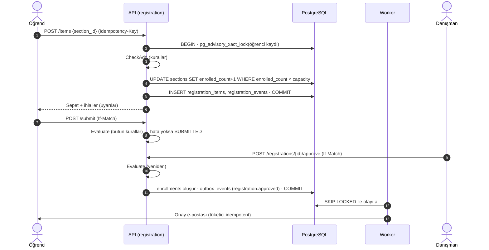

# 09 · Ders Seçme: Kural Kataloğu ve Akış

> **Durum:** Faz 3'te uygulandı · İlgili: [04 · Veri Modeli §7](04-veri-modeli-oltp.md#7-enrollment--program-kaydı-ve-ders-seçme), [03 · Politika fonksiyonları](03-kimlik-dogrulama-ve-yetkilendirme.md#45-ilişki-ve-bağlam-kuralları-politika-fonksiyonları), [08 · Yük Testleri](08-yuk-testleri.md)
>
> Kod: `backend/internal/registration/rules` (saf Go, veritabanına dokunmaz, tablo güdümlü testler) ve onu çağıran `backend/internal/registration` servisi.

## 1. İlkeler

- **Kurallar kodda, parametreler veride.** Kural mantığı `rules` paketindedir; sayısal sınırlar `curriculum.regulation_parameters` tablosundan okunur ve yönetmelik değişince kod değişmeden güncellenir (bkz. §4).
- **Hata ve uyarı ayrımı.** `ERROR` sepete eklemeyi, gönderimi ya da onayı engeller. `WARNING` sadece bilgilendirir (ör. not yükseltme), öğrenci ve danışman görür.
- **İki kural kümesi.** `CheckAdd` ders eklenirken (ve şube değişirken) sadece o dersi denetler. `Evaluate` bütün sepeti denetler: gönderimde, onayda ve sepet her görüntülendiğinde çalışır. Sıraya bağlı kurallar (1. sınıf zorunluları, alttan önceliği) yalnız `Evaluate`'tedir: öğrenci sepetini hangi sırayla doldurursa doldursun ara adımlarda engellenmez.
- **Yeniden değerlendirme.** Onay anında sepet yeniden değerlendirilir: gönderimden sonra konan bir engel ya da değişen bir parametre onayı durdurur.
- **Makine okunur sonuç.** Her ihlal `code`, `severity`, ilgili ders kimlikleri (`course_ids`) ve parametreleri (`params`) taşır; Türkçe `message` yedektir. Web arayüzü metni `code` ve `params`'tan kendi dilinde üretir.

## 2. Kural kataloğu

| Kod | Önem | Ne zaman | Kural |
| --- | --- | --- | --- |
| `HOLD` | Hata | Ekleme, sepet | Ders seçmeyi kapatan aktif bir kayıt engeli var (`holds.blocks` içinde `REGISTRATION`): katkı payı borcu, disiplin cezası, eksik belge, kütüphane borcu. Engeller adlarıyla listelenir |
| `PROGRAM_NOT_ACTIVE` | Hata | Ekleme, sepet | Program kaydı aktif değil (dondurulmuş, uzaklaştırılmış, ilişiği kesilmiş, mezun) |
| `NO_CURRICULUM` | Hata | Ekleme, sepet | Öğrenci bir ders planına bağlı değil |
| `EMPTY_BASKET` | Hata | Sepet | Boş sepet gönderilemez. Arayüz boş sepette bu satırı göstermez (boş durum zaten söyler) ama yukarıdaki üç kuralı gösterir: öğrenci ders eklemeye çalışmadan nedenini görür |
| `DUPLICATE_COURSE` | Hata | Ekleme | Dersin bir şubesi zaten sepette; şube değiştirilir. Veritabanında kısmi benzersiz index de korur |
| `NOT_IN_CURRICULUM` | Hata | Ekleme, sepet | Ders öğrencinin müfredatında bir satırı ya da seçmeli yuvasını karşılamıyor (eşdeğerlikler dahil: eski kodundan kalınan ders yeni koduyla alınır) |
| `PREREQUISITE` | Hata | Ekleme, sepet | Ön koşul sağlanmıyor. Aynı gruptaki ön koşullar VEYA, gruplar VE ile bağlanır. Tür: `PASSED` (dersi geçmiş olmak) ya da `ATTENDED` (devam etmiş, devamsızlıktan kalmamış olmak). Eşdeğer dersler sayılır |
| `SCHEDULE_CONFLICT` | Hata / Uyarı | Ekleme, sepet | İki şubenin haftalık oturumları çakışıyor. Derslerden birinin devam şartı daha önce sağlanmışsa (tekrar alınan ders) uyarıdır: öğrenci o derse devam etmek zorunda değildir |
| `ECTS_LIMIT` | Hata | Ekleme, sepet | Sepetin AKTS toplamı öğrencinin üst sınırını aşıyor. Sınır GANO basamağına göredir; GANO'su olmayan öğrenci (1. yarıyıl) dönem yüküyle sınırlıdır |
| `FIRST_YEAR_COMPULSORY` | Hata | Sepet | 1. sınıftaki (ilk iki yarıyıl) öğrenci yarıyılının, açılmış ve ön koşulu sağlanan bütün zorunlu derslerini almalı |
| `REPEAT_PRIORITY` | Hata | Sepet | Alt yarıyıllardan kalınan ya da hiç alınmamış zorunlu dersler, kendisi ya da eşdeğeri açılmışsa ve ön koşulu sağlanıyorsa öncelikle alınmalı |
| `MAX_DURATION` | Hata | Ekleme, sepet | Azami öğrenim süresini aşan öğrenci, mezuniyet için kalan ders sayısı sınırı (5) aşmıyorsa sadece kalan derslerini alabilir; aşıyorsa hiç ders seçemez ve öğrenci işlerine yönlendirilir |
| `REPEAT_UPGRADE` | Uyarı | Ekleme, sepet | Geçilmiş ders not yükseltmek için alınıyor; son alınan not geçerli olur. BŞR/BŞZ gibi notsuz geçilen dersler not yükseltmeye sunulmaz |
| `ELECTIVE_SLOT_EXCEEDED` | Uyarı | Ekleme, sepet | Bir seçmeli havuzundan ders planının gerektirdiğinden fazla ders alınıyor |

Kural motoru dışındaki, işlemin kendisini reddeden durumlar (HTTP problem kodlarıyla):

| Kod | HTTP | Durum |
| --- | --- | --- |
| `SECTION_FULL` | 409 | Şubenin kontenjanı dolu (koşullu atomik `UPDATE` 0 satır döndürdü) |
| `QUOTA_FULL` | 409 | Ayrılmış kontenjanlı şubede programa ayrılan kontenjan dolu |
| `SECTION_NOT_FOR_PROGRAM` | 409 | Ayrılmış kontenjanlı şube öğrencinin programına yer ayırmamış |
| `SECTION_NOT_OPEN` | 409 | Ders açılmamış, kapatılmış ya da şube iptal edilmiş |
| `WINDOW_CLOSED` | 409 | İşlemin takvim penceresi kapalı (kayda tanınmış ek süre yoksa) |
| `REGISTRATION_LOCKED` | 409 | Kayıt danışman onayında ya da onaylanmış; önce geri çekilmeli |
| `VERSION_MISMATCH` | 412 | Kayıt başka bir sekmede ya da kişi tarafından değişmiş (`If-Match`) |
| `RULE_VIOLATION` | 422 | Kural motoru hata döndürdü; gövdede `violations` listesi |

## 3. Alınabilir dersler

`GET /student-programs/{id}/registration/offer`, öğrencinin müfredatını, ders geçmişini ve dönemin açılan derslerini birleştirir. Her ders tek kategoride, şu sırayla gelir:

| Kategori | İçerik |
| --- | --- |
| `REPEAT` (alttan) | Alt yarıyıllardan kalınan ya da alınmamış zorunlu dersler. Eski kodlu ders kapandıysa yeni eşdeğeri sunulur ("PHY0101 yerine sayılır") |
| `CURRENT` | İçinde bulunulan yarıyılın zorunlu dersleri |
| `ELECTIVE` | Dolmamış seçmeli yuvaları için havuzun geçilmemiş dersleri |
| `UPPER` | Üst yarıyılların zorunlu dersleri (ön koşul durumu gösterilir) |
| `UPGRADE` | Harf notuyla geçilmiş dersler (not yükseltme) |

Her ders için şubeler, programa göre kalan kontenjan, haftalık program ve ön koşulun sağlanıp sağlanmadığı döner. Kayıt penceresi açılışında aynı veriyi binlerce öğrenci aynı anda istediği için müfredat, katalog ve yönetmelik parametreleri süreç içinde kısa süre önbelleğe alınır; kontenjan her istekte taze okunur (bkz. [08](08-yuk-testleri.md)).

## 4. Yönetmelik parametreleri

| Anahtar | Varsayılan | Kullanan kural |
| --- | --- | --- |
| `ects_limit_by_gpa` | GANO ≤ 1,99 → 30 · ≤ 2,99 → 40 · ≤ 4,00 → 45 | `ECTS_LIMIT` |
| `semester_ects_load` | 30 | `ECTS_LIMIT` (GANO'su olmayan öğrenci) |
| `max_courses_after_max_duration` | 5 | `MAX_DURATION` |

Parametreler tarih aralıklıdır (`effective_from`, `effective_to`); kural motoru o gün geçerli değeri kullanır. Gönderim anındaki sınır ve GANO kayda yazılır (`max_ects_allowed`, `gpa_snapshot`): danışman öğrencinin hangi sınırla seçtiğini görür.

## 5. Akış

- **Pencereler.** Ders seçme (`COURSE_REGISTRATION`), danışman onayı (`ADVISOR_APPROVAL`), ekle-bırak için öğrenci, danışman ve bölüm başkanı pencereleri (`ADD_DROP_STUDENT`, `ADD_DROP_ADVISOR`, `ADD_DROP_DEPT_HEAD`). Pencere program, birim ya da üniversite kapsamında tanımlanır; en özel kapsam geçerlidir. Pencere sorgusu transaction'dan önce yapılır: kilit beklerken bağlantı havuzunu tüketmesin.
- **Ek süre.** Öğrenci işleri (`registration:override`) bir kayda gerekçeli ek süre tanıyabilir (`extension_until`); o kayıt için ders seçme ve onay pencereleri o ana kadar açık sayılır.
- **Süresi dolan taslaklar.** Ders seçme penceresi bittiğinde gönderilmemiş (taslak ya da geri gönderilmiş) sepetlerin ayırdığı kontenjanı worker serbest bırakır ve olay günlüğüne `EXPIRED` yazar. Ek süresi süren kayıtlara dokunulmaz.
- **Ekle-bırak.** Onaylı kayıtta öğrenci tek bir talepte ders ekler ve bırakır. Eklenecek şubenin kontenjanı talep anında ayrılır (onay beklerken başkası dolduramasın), red ya da geri çekmede iade edilir. Talep danışman ve bölüm başkanı onayından sonra kayda uygulanır; bırakılan dersin yeri o anda açılır. Uygulama `registration.add_drop_applied` olayını yayımlar.
- **Olaylar.** `registration.approved`, `registration.rejected`, `registration.approval_revoked` (öğrenciye e-posta; Faz 5'te LMS üyeliği), `registration.add_drop_applied`, `term.made_current` (aktif öğrencilerin yarıyılı bir kez ilerler).
